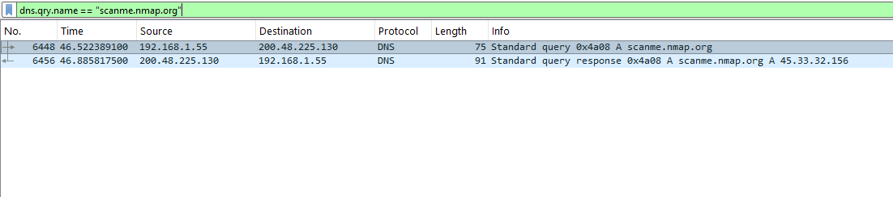
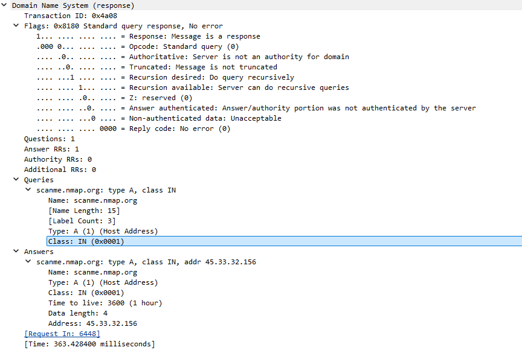
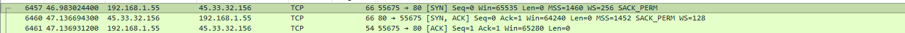
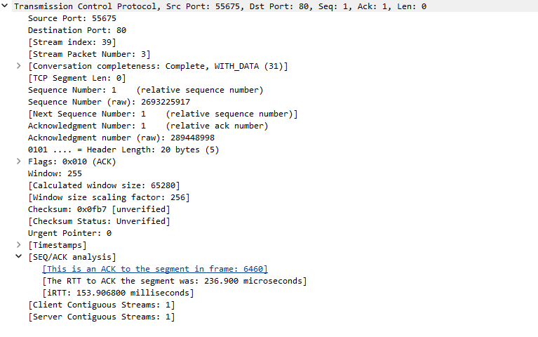
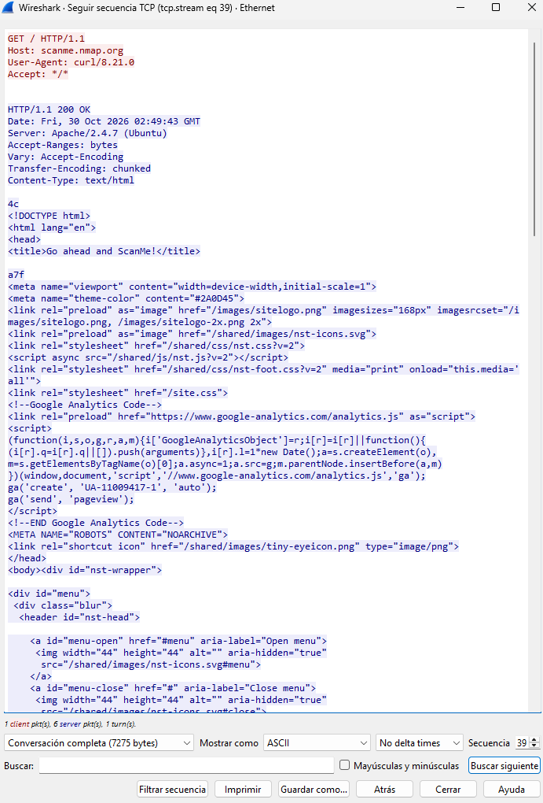
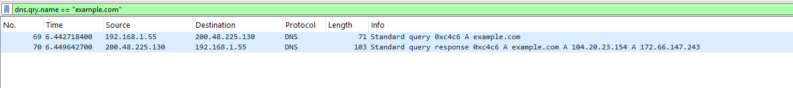
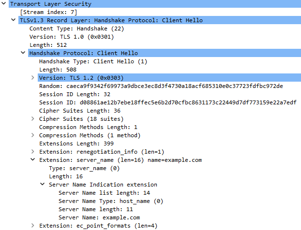
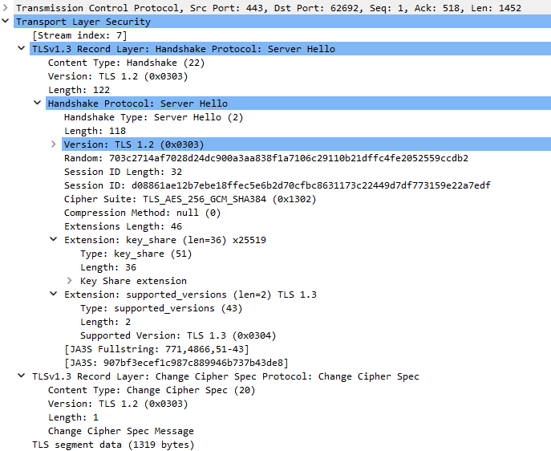
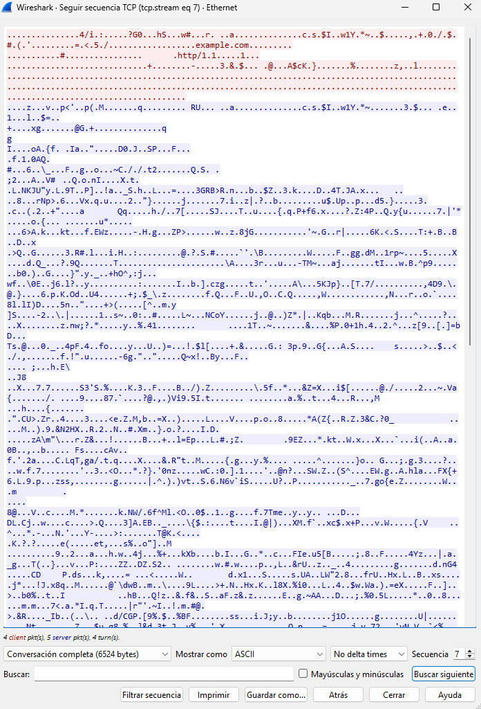
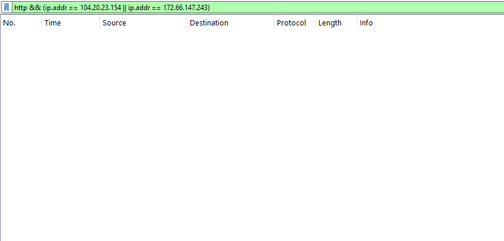

# analisis-trafico-wireshark
 
Análisis documentado, con capturas de Wireshark, de lo que ocurre en la red cuando se abre una página web: la consulta DNS, el *handshake* TCP y la petición HTTP, y después la misma conexión con HTTPS (TLS 1.3). El objetivo es comprobar con evidencia propia qué ve un observador de la red en cada caso.
 
## Objetivo
 
- Entender y mostrar, paquete por paquete, cómo funcionan DNS, el handshake de tres pasos de TCP y una petición HTTP.
- Comparar el mismo tipo de conexión sin cifrar (HTTP) y cifrada (HTTPS/TLS 1.3), e identificar qué información sigue siendo visible y cuál no.
- Documentar los problemas reales que aparecieron durante las pruebas, no solo los resultados limpios.
## Entorno y herramientas
 
- **Wireshark 4.6** en Windows 11, capturando en la interfaz Ethernet.
- **curl** (`curl.exe`, incluido en Windows) para generar el tráfico de forma controlada, con `-4` para forzar IPv4 y que todo quede en un solo flujo fácil de filtrar.
- Destinos de prueba: `scanme.nmap.org` (HTTP) y `example.com` (HTTPS).
## Metodología y consideraciones éticas
 
- Solo se captura **tráfico propio**, generado por mis comandos, en mi red. Capturar el tráfico de otras personas sin permiso es ilegal.
- `scanme.nmap.org` es un servidor que el proyecto Nmap permite usar para pruebas con moderación; solo se hizo **una** petición a su página web.
- Antes de cada captura se cierran los demás programas y se vacía la caché DNS (`ipconfig /flushdns`) para que la consulta DNS aparezca en la captura.
- Cada captura de pantalla se hace con un filtro que deja solo los paquetes del experimento y se recorta para no mostrar direcciones MAC ni datos de otros programas.
- **Los archivos `.pcapng` no se publican** en este repositorio (el `.gitignore` los excluye): contienen las direcciones MAC de los equipos de la red local y datos del sistema donde se capturó.
## Experimento 1: HTTP (sin cifrar)
 
Tráfico generado con:
 
```powershell
ipconfig /flushdns
curl.exe -4 -s -o NUL -w "%{http_code}\n" http://scanme.nmap.org
```
 
### 1. Consulta DNS
 
Antes de conectar, el equipo necesita la IP del nombre. Envía una consulta DNS tipo **A** por **UDP al puerto 53** del servidor DNS de la red (`200.48.225.130`).
 

 
- La consulta (`0x4a08`) lleva activada la bandera *Recursion desired*: le pide al servidor que haga la búsqueda completa por mí.

 
- La respuesta devuelve **45.33.32.156**, con *Recursion available* activada y *Authoritative* desactivada: responde un servidor intermedio, no el oficial del dominio. La consulta y la respuesta se emparejan por el *Transaction ID*.
- El **TTL es de 3600 s** (1 hora): durante ese tiempo cualquiera puede guardar la respuesta en caché.
- La respuesta tardó **363 ms**.

 
### 2. Handshake TCP
 
Los tres primeros paquetes establecen la conexión de mi equipo (puerto aleatorio 55675) con el puerto 80 del servidor:
 

 
| Paquete | Banderas | Ventana | Opciones |
|---|---|---|---|
| Equipo → servidor | `SYN` | 65535 | MSS 1460, WS 256, SACK_PERM |
| Servidor → equipo | `SYN, ACK` | 64240 | MSS 1452, WS 128, SACK_PERM |
| Equipo → servidor | `ACK` | 65280 | — |
 
- El **tiempo ida y vuelta (iRTT) fue de 153,9 ms**, que coincide con la diferencia entre el SYN y el SYN-ACK.
- Wireshark muestra números de secuencia *relativos* (empiezan en 0); los reales son aleatorios, lo que dificulta que un atacante inyecte paquetes en una conexión ajena.
- El **MSS** negociado por el servidor (1452) explica que después envíe la página en segmentos de exactamente 1452 bytes.

 
### 3. Petición HTTP
 
Con **Seguir → Flujo TCP** se ve la conversación completa **en texto legible**:
 

 
- La petición (`GET / HTTP/1.1`, de 79 bytes) revela el sitio (`Host`) y el programa que la hizo (`User-Agent: curl/8.21.0`).
- La respuesta (`200 OK`, 7196 bytes en total) muestra el software del servidor: `Server: Apache/2.4.7 (Ubuntu)`. Es una versión antigua, pero no prueba por sí sola que el servidor sea vulnerable, porque las distribuciones aplican parches de seguridad sin cambiar el número de versión.
- El cuerpo llega en trozos (`Transfer-Encoding: chunked`): las líneas sueltas como `4c` y `a7f` son la longitud de cada trozo en hexadecimal.
- La conexión se cierra con `FIN, ACK` de cada lado y un último `ACK`.
**Todo lo anterior lo puede leer cualquiera que esté en el camino**: cabeceras, cookies (si las hubiera) y contenido.
 
## Experimento 2: HTTPS (TLS 1.3)
 
Tráfico generado con:
 
```powershell
ipconfig /flushdns
curl.exe -4 -s -o NUL -w "%{http_code}\n" https://example.com
```
 
### 1. El DNS sigue siendo visible
 

 
La consulta DNS va por UDP **sin cifrar** aunque la web use HTTPS. Quien esté en el camino ve qué dominio se pide. La respuesta devolvió dos IPs (`104.20.23.154` y `172.66.147.243`), algo típico de las redes de distribución de contenido (CDN), y llegó en unos 7 ms.
 
### 2. Client Hello: el nombre del sitio va en claro
 

 
- Mi equipo ofrece **18 cipher suites**.
- La extensión **`server_name` (SNI)** contiene `example.com` **en texto claro**: es el nombre del sitio que se visita, visible aunque todo lo demás vaya cifrado.
- Los campos de versión muestran valores antiguos (`TLS 1.0` en el registro, `TLS 1.2` en el Client Hello) por compatibilidad con equipos intermedios; la versión real se negocia en la extensión `supported_versions`.
### 3. Server Hello: qué se acuerda
 

 
- Versión real negociada: **TLS 1.3** (`supported_versions`).
- Suite elegida: **`TLS_AES_256_GCM_SHA384`**: cifrado AES de 256 bits en modo GCM (cifra y autentica) y SHA-384 para derivar las claves.
- Intercambio de claves con **x25519** (`key_share`): las claves se generan nuevas en cada sesión, de modo que aunque alguien guardara hoy el tráfico y robara después la clave privada del servidor, no podría descifrarlo (*forward secrecy*).
- Después del Server Hello, **todo va cifrado**, incluido el certificado del servidor: con el filtro `tls.handshake.type == 11` (mensaje *Certificate*) no aparece ningún paquete. En TLS 1.2 el certificado viajaba en claro.
### 4. Los datos, cifrados
 

 
En el flujo TCP de la conexión solo se leen el SNI (`example.com`) y la extensión ALPN (`http/1.1`), que van en el Client Hello. La ruta, las cabeceras y el contenido son ilegibles.
 

 
Con el filtro `http` aplicado a las IPs de `example.com` no aparece ningún paquete. Matiz importante: la petición HTTP **existe**, pero va dentro del túnel TLS y Wireshark no puede interpretarla sin las claves de sesión.
 
## Comparación: qué ve un observador de la red
 
| Dato | HTTP (`scanme.nmap.org`) | HTTPS (`example.com`) |
|---|---|---|
| Consulta DNS (dominio) | visible | visible |
| IP de destino y puerto | visible (puerto 80) | visible (puerto 443) |
| Nombre del sitio | visible (`Host`) | visible (SNI) |
| Ruta pedida | visible | cifrada |
| Cabeceras (`User-Agent`...) | visibles | cifradas |
| Software del servidor (`Server:`) | visible | cifrado |
| Contenido de la respuesta | visible | cifrado |
| Certificado del servidor | no aplica | cifrado (TLS 1.3) |
| Tamaño y momento de los paquetes | visibles | visibles |
 
## Hallazgos adicionales
 
**Un puerto filtrado, visto en la red.** Mi primer intento de HTTP fue contra `neverssl.com`. En la captura aparecía el `SYN` seguido de **cuatro retransmisiones** a los 1, 2, 4 y 8 segundos aproximadamente (*exponential backoff*) y **ningún SYN-ACK ni RST**. `curl` terminó por tiempo de espera y `Test-NetConnection` falló tanto por IPv4 como por IPv6. Cuando un SYN no recibe respuesta alguna, el puerto se considera *filtrado*; un puerto cerrado habría contestado de inmediato con un RST. Como mi red sí alcanzaba el puerto 80 de otros servidores, cambié el destino a `scanme.nmap.org`.
 
**El TTL cambia mucho entre dominios.** `neverssl.com` respondió con TTL de 60 s y `scanme.nmap.org` con 3600 s. Un TTL corto permite cambiar de IP rápido pero obliga a consultar más veces; uno largo reduce el tráfico, pero prolonga el efecto de una respuesta falsa si alguien envenena la caché de un servidor DNS.
 
**Tiempos de DNS distintos.** La misma consulta tardó unos 7-11 ms para `example.com` y `neverssl.com`, y 363 ms para `scanme.nmap.org`. Mi hipótesis, sin comprobar, es que los dominios más populares ya estaban en la caché del servidor DNS y el otro obligó a una búsqueda completa.
 
**Consultas A y AAAA simultáneas, y puertos aleatorios.** Sin forzar IPv4, el equipo envía a la vez una consulta A (IPv4) y una AAAA (IPv6), y las respuestas pueden llegar en desorden: por eso se emparejan por el *Transaction ID* y no por el orden. Cada consulta salió desde un puerto de origen distinto; esa aleatorización, junto con el ID aleatorio, dificulta que un atacante falsifique la respuesta.
 
**HTTPS también arrastra tráfico sin cifrar.** Durante la captura apareció una petición HTTP a la autoridad certificadora (`SSL.com`) para descargar una lista de revocación de certificados. Es normal: esas listas van firmadas, y la comprobación se hace por HTTP. Un observador puede deducir así qué autoridad firmó el certificado del sitio.
 
## Cómo reproducirlo
 
Filtros de visualización usados en Wireshark:
 
```
dns.qry.name == "scanme.nmap.org"
ip.addr == 45.33.32.156 && tcp
http
tls.handshake.type == 1        # Client Hello
tls.handshake.type == 2        # Server Hello
tls.handshake.type == 11       # Certificate (vacío en TLS 1.3)
tcp.stream eq 7                # flujo de la conexión HTTPS (el número cambia en cada captura)
```
 
Para guardar solo lo relevante: **Archivo → Exportar paquetes especificados → Displayed**.
 
## Limitaciones y mejoras futuras
 
- Solo se analizó IPv4 (`curl -4`); el equipo también tiene conectividad IPv6, que no se estudió.
- No se descifró el tráfico TLS. Una mejora es guardar las claves de sesión del cliente (`SSLKEYLOGFILE`) en un laboratorio propio para que Wireshark muestre el HTTP dentro del túnel.
- Un solo servidor por protocolo; sería útil comparar también TLS 1.2 con TLS 1.3 y HTTP/2 con HTTP/1.1.
- El SNI sigue visible; la extensión *Encrypted Client Hello* lo oculta, pero requiere soporte de cliente y servidor.
- Reutilizar las capturas con un script de Python y Scapy para extraer automáticamente protocolos e IPs más activas (siguiente proyecto del portafolio).
## Aviso
 
Este análisis es educativo y se hizo solo con tráfico generado por mí en mi propia red. Capturar tráfico ajeno sin autorización puede constituir una infracción legal.
